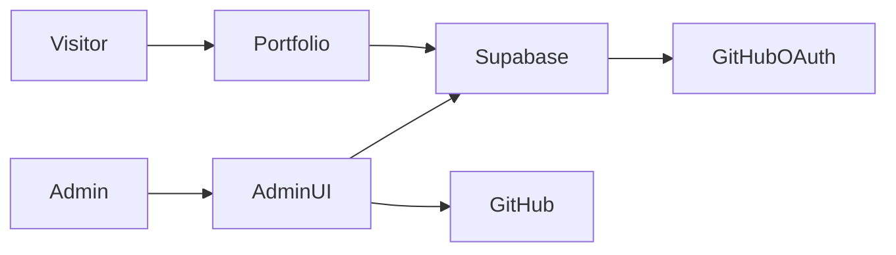

# Requirements

### Overview
Add a private admin area for manually managing projects, skills, experience, and profile/about text. Changes appear on the public portfolio after saving; no GitHub synchronization runs automatically.

### Admin workflow
- Sign in with an individually provisioned Supabase email/password account. Only the designated admin can modify content.
- Create, edit, reorder, and delete projects, skills, and experience; edit profile, hero, and about text. Confirm deletions and show validation, loading, success, and error states.
- Connect GitHub and explicitly select a public or private repository to prefill a project form. Review and edit fields before saving; warn that saved private-repository details and links become public. Avoid duplicate imports.
- Preserve the existing public design, responsive layout, theme, safe project links, and project data. Profile-image uploads are outside this scope.

### Prerequisites and security
- The existing Supabase URL needs a publishable/anon key; the configured secret key must not reach the browser. Rotate it if exposed.
- A GitHub OAuth app, Supabase GitHub provider, manual identity linking, redirect URLs, and the admin account must be configured by the project owner. GitHub OAuth's `repo` scope grants broad private-repository read/write access, although the importer only reads metadata.

# Technical Design

### Current implementation
`src/App.jsx` reads the `project` table via `utils/supabase.js`, while profile, skills, and experience are hard-coded. `vite.config.js` targets GitHub Pages at `/pern-portfolio/`; `server.cjs` is a separate local PostgreSQL API and will not be used. No database migrations or admin authentication exist in the repository.

### Design and contracts
- Keep the static React app and shared Supabase browser client. Use an `#admin` view compatible with existing section anchors and the GitHub Pages base path; handle OAuth callbacks at the base URL and return to the admin view.
- Add versioned Supabase SQL for public-read portfolio content and admin-only writes. Before applying it, inspect the live `project` schema and policies: preserve rows and its actual primary key (`projectID` or `id`), add only compatible columns, and remove or tighten any conflicting permissive write policies. Seed the current hard-coded content only when the corresponding new tables are empty; never overwrite existing content.
- Data contracts: retain `project_title`, `description`, `language`, and optional `project_url`; add ordering and an optional unique GitHub repository identifier. Store ordered skills (`title`, `details`), ordered experience (`title`, `role`, `description`), and a singleton profile containing the existing name, hero, and about text. Render text as text and accept only HTTP(S) project links.
- Enforce authorization in PostgreSQL RLS, not UI checks: public reads for portfolio tables, writes only when `auth.uid()` is in a server-managed admin allowlist. Prevent browser users from changing that allowlist; disable public signup and provision the admin separately. Client-side admin checks provide UX only.
- Use Supabase email/password sign-in and session handling. Link GitHub to the authenticated admin using Supabase `linkIdentity`; on later imports reauthorize the already-linked identity to obtain a provider token, verify the returned user is the same admin, and handle denied, expired, or conflicting identities. Linking also enables GitHub sign-in to that Supabase account; RLS still controls access.
- For private imports request GitHub OAuth `repo` scope, list accessible repositories with pagination, and map `node_id`, `name`, `description`, `language`, and `html_url` into a draft. Do not fetch source code or save automatically. Explain private-link visibility and detect an existing imported ID before saving.
- Do not persist or log GitHub provider tokens: use a tested Supabase auth storage adapter that strips provider tokens from persisted sessions while retaining the PKCE verifier across redirects; hold the current token only in memory and reauthorize when unavailable. Never expose the OAuth client secret or Supabase secret/service-role keys in client code.

### Files
- Modify `src/App.jsx` and `src/App.css` for data-backed public sections and admin navigation; reuse theme tokens in `src/index.css`.
- Add `src/admin/` components/styles for authentication, editors, and GitHub import; add `utils/` helpers for content access, auth storage, and GitHub mapping.
- Add `supabase/migrations/` SQL and update `README.md` with schema, owner provisioning, RLS, OAuth setup, redirects, deployment, and key-rotation guidance. Extend `tests/` using the existing Node test pattern.

### Flow

### Risks
The actual Supabase schema and existing policies must be inspected before migration; stop rather than guess if incompatible. OAuth linking is a Supabase beta feature, and GitHub organization policies may restrict access. Private details are published only after explicit review and confirmation.

# Testing

### Validation
- Run `node --test`, `npm run lint`, and `npm run build`; add focused Node tests for mapping, validation, ordering, duplicate detection, and token-safe session storage.
- With an isolated configured Supabase project, verify public reads, admin CRUD, rejection of anonymous and non-admin writes, existing-project preservation, and non-destructive seeding. If credentials or an isolated project are unavailable, report the integration checks as unverified rather than claiming success.
- Verify email sign-in/sign-out, OAuth link and repeat authorization, redirect handling under `/pern-portfolio/`, private-repository review, pagination, denied/expired access, and GitHub rate-limit/network failures. Confirm provider tokens and privileged keys do not appear in persisted browser storage, logs, or build output.
- Check public rendering, empty/error states, dark/light themes, keyboard use, responsive layouts, and safe URL behavior after changes.

# Delivery Steps

### ! Step 1: Establish portfolio data and access policies
Portfolio content has a non-destructive Supabase schema and admin-only write authorization.
- Inspect the live `project` schema and policies before preparing compatible SQL in `supabase/migrations/`.
- Preserve project rows; add ordered content tables, a protected admin allowlist, and restrictive RLS.
- Seed existing static content only into empty tables and document safe owner provisioning.
- Verify migration and authorization against an isolated Supabase project when available.

###   Step 2: Add admin sign-in and navigation
The designated owner can reach a protected admin view and sign in with email and password.
- Add base-path-safe admin navigation and Supabase session handling using `src/App.jsx` and `src/admin/`.
- Reject non-admin sessions in the UI while relying on RLS for actual authorization.
- Add token-safe auth storage and callback handling, and test sign-in, sign-out, session restoration, and missing configuration.

###   Step 3: Manage projects manually
Admins can create, edit, reorder, and delete project cards while visitors see saved records.
- Add project forms and validation in `src/admin/`, retaining the existing project-table contract and safe external links.
- Update public project loading in `src/App.jsx` for stable ordering and clear loading, empty, and error states.
- Test project CRUD, link validation, and unauthorized writes.

###   Step 4: Manage profile, skills, and experience
Admins can update the remaining portfolio text and visitors see the saved content.
- Add editors for profile/hero/about text and ordered skills and experience entries.
- Replace corresponding hard-coded rendering in `src/App.jsx`, preserving the existing visual style and accessible feedback.
- Test persistence, ordering, deletion confirmation, and public rendering.

###   Step 5: Add reviewed GitHub repository imports
An admin can connect GitHub and manually import reviewed public or private repository metadata.
- Link GitHub to the admin account, request the agreed `repo` scope, and support repeat authorization without persisting provider tokens.
- List repositories with pagination; prefill an editable project draft and warn before publishing private details.
- Prevent duplicate imports and handle permission, redirect, token, rate-limit, and network errors.
- Document GitHub/Supabase setup and validate the flow, build, lint, and relevant tests.